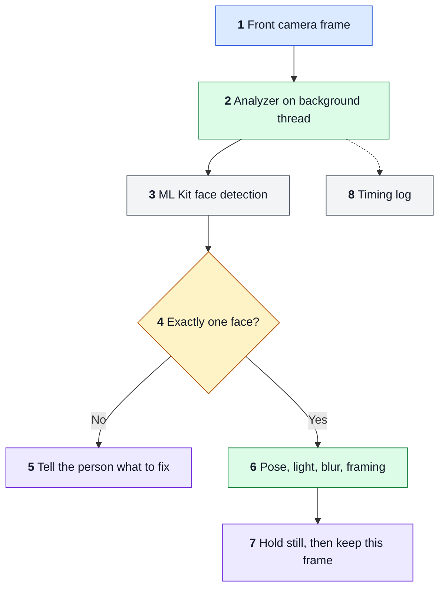
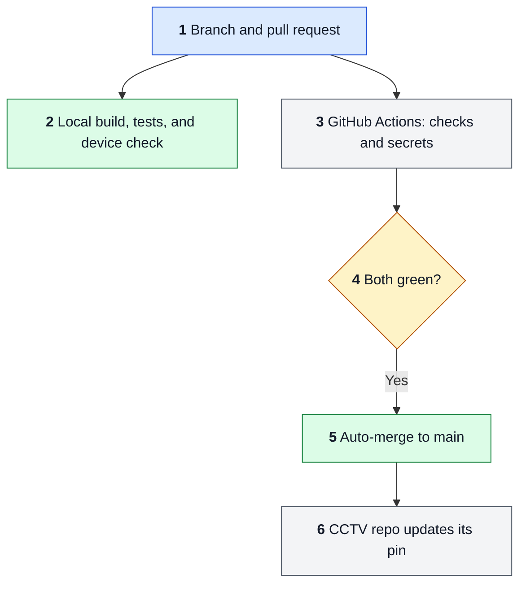

<div align="center">

# Face Dataset Collector

**Guided, consent-first face enrolment for the CCTV Face Recognition Attendance System.**

Staff sign in on an Android phone or tablet, record consent, and capture a clean, checked photo set. Photos stay in memory and go only to the enrolment server.

[](https://github.com/hamza-aziz-ai/Face-Dataset-Collector/actions/workflows/ci.yml)
[](https://github.com/hamza-aziz-ai/Face-Dataset-Collector/actions/workflows/secrets.yml)


[System Design](#system-design) · [Solution Architecture](#solution-architecture) · [Quick start](#quick-start) · [Documentation](#documentation) · [Known limitations](#known-limitations)

</div>

---

> [!IMPORTANT]
> **Not released and not sold.** This app handles real people's faces, so it follows the Lane B process in [`docs/`](docs/). Real-server use is limited to the owner's own face (D-024, D-025).

## At a glance

| | Capability | What it means |
|:-:|---|---|
| 🔐 | **Signed setup** | Staff connect by scanning a setup QR code signed with an offline key, then sign in. No shared password or API key is in the app. |
| 📝 | **Consent first** | The site's notice is shown and consent is recorded before the camera opens. Staff can withdraw consent from any cancel dialog. |
| 🎯 | **Guided capture** | 5 poses, or 10 with glasses. On-device checks for one face, pose angle, light, blur, and framing, with plain-language feedback. |
| 🧠 | **On-device detection** | Bundled ML Kit and ZXing run on the device. No frame leaves the device for checking. |
| 🛡️ | **Private by design** | Photos are held in memory until the server accepts them. They never reach the gallery or backups. |
| 🗂️ | **Roster management** | Register people by organisation ID, re-enrol with a reason, and remove a person with the server's deletion promise. |
| 📱 | **Phone and tablet** | Every screen works in portrait and landscape, in light and dark themes. |

## How enrolment works

| Step | Staff action | App behaviour |
|:-:|---|---|
| **1** | Scan the site's setup code and sign in | Checks the code's signature, then signs in to the enrolment server |
| **2** | Find or register the person | Searches the roster, or registers a new organisation ID after a confirm step |
| **3** | Show the notice and record consent | Sends consent to the server before any capture starts |
| **4** | Guide the person through each pose | Keeps the first frame that passes every check |
| **5** | Review and upload | Uploads the set, then shows whether the server accepted it or which photos to retake |

The full trace of each flow is in [`docs/FLOW.md`](docs/FLOW.md).

## System Design

What happens to one camera frame during capture. Solid arrows are the path every frame takes. Dotted arrows are written on the side.



1. **Frame arrives.** CameraX delivers only the latest frame, so a slow check never builds a queue.
2. **Background thread.** Judging happens off the main thread so the UI stays smooth.
3. **On-device detection.** The bundled ML Kit model runs on the device. ML Kit's telemetry library was audited, kept, and disclosed (D-013).
4. **One person only.** No face or several faces fail straight away.
5. **Clear feedback.** The person sees what to fix. A detector error has its own message rather than reading as "no face".
6. **Quality checks.** Pose angle, light on the face, a real blur check, and framing, all from `QualityPolicy.kt`.
7. **Keep the frame.** After a steady moment, the exact frame that passed is cropped to 4:5 and held in memory.
8. **Timing.** Aggregate timings only, never anything about the person.

## Solution Architecture

How a change reaches a device. Every arrow is running today.



1. **Pull request.** One logical change per PR. Docs-only changes go straight to `main` with `[skip ci]`.
2. **Local check.** `assembleDebug`, unit tests, and lint, then `EnrolmentFlowTest` against the mock server on a CPH2381 phone (API 34) or an OPD2203 tablet (API 36).
3. **CI.** `ci.yml` builds, tests, and lints every code change. `secrets.yml` scans every change for secrets, docs included.
4. **Ruleset.** `main` needs both jobs green, and blocks force pushes and deletion.
5. **Merge.** Auto-merge lands the PR once checks pass. Codex review comments are read after and fixed in a follow-up PR.
6. **Downstream.** After a green `main`, CI asks the CCTV repo to update its submodule pin. Release builds are signed by hand by the owner (D-022). There is no store release yet.

## Tech stack

| Layer | Choice |
|---|---|
| Language and UI | Kotlin 2.4, Jetpack Compose, IBM Plex Sans |
| Camera and vision | CameraX 1.6, ML Kit face detection (bundled), ZXing core |
| Networking | OkHttp 5, redirects refused, one idempotency key per upload |
| Platforms | Android 6.0 (API 23) and up, targets API 36, compiles against API 37 |
| Test server | Python mock in [`tools/mock_server/`](tools/mock_server/), standard library only |

## Quick start

Requires Android Studio, which provides the JDK and the Android SDK (platform 37).

```bash
export JAVA_HOME="<Android Studio>/jbr"
./gradlew assembleDebug testDebugUnitTest lintDebug
```

Run the mock server (ports 8081 and 8082, development only) and its tests:

```bash
python tools/mock_server/mock_server.py
python -m unittest discover -s tools/mock_server
```

Device test steps are in [`docs/TESTING.md`](docs/TESTING.md).

## Documentation

| File | Covers |
|---|---|
| [`docs/HANDOVER.md`](docs/HANDOVER.md) | Where things stand |
| [`docs/FLOW.md`](docs/FLOW.md) | Detailed system design |
| [`docs/ARCHITECTURE.md`](docs/ARCHITECTURE.md) | Detailed solution architecture |
| [`docs/DECISIONS.md`](docs/DECISIONS.md) | What was chosen and why |
| [`docs/CONSTRAINTS.md`](docs/CONSTRAINTS.md) | Hard rules |
| [`docs/THREAT.md`](docs/THREAT.md) | Who could abuse it |
| [`docs/DATA.md`](docs/DATA.md) | Structures and retention |
| [`docs/TESTING.md`](docs/TESTING.md) | How changes are verified |
| [`docs/ROLLBACK.md`](docs/ROLLBACK.md) | Last good commit and how to go back |
| [`docs/features/FEATURE-001-enrolment.md`](docs/features/FEATURE-001-enrolment.md) | Enrolment plan and API contract |

## Known limitations

- Quality thresholds are measured on one face only, the owner's.
- The glasses warning rests on one face and one pair of glasses.
- Nothing checks a typed ID against a real ID card.
- Legal advice on the notice, retention, and legal basis is still pending (D-005).
