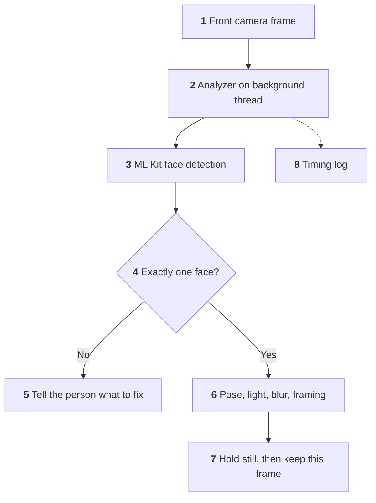
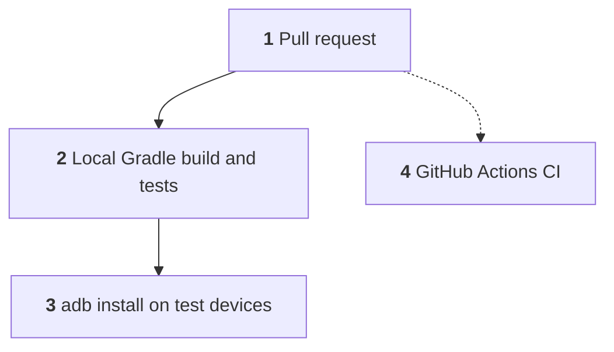

# Face-Dataset-Collector

Android app for enrolling a person's face for the CCTV Face Recognition Attendance System. It handles real people's faces, so it follows the Lane B process in [`docs/`](docs/).

**Status:** not released and not sold. Staff can connect to a server by signed QR code and sign in, capture guided poses, review them, upload to the mock server, and re-enrol someone with a reason. Photos stay in memory until the server accepts them. The enrolment flow is being built against a mock server.

## System Design

What happens to one camera frame during capture. Solid arrows are the path every frame takes. Dotted arrows are written on the side.



1. **Frame arrives.** CameraX delivers only the latest frame, so a slow check never builds a queue.
2. **Background thread.** Judging happens off the main thread so the UI stays smooth.
3. **On-device detection.** The bundled ML Kit model runs on the device. ML Kit's telemetry library has network access and has not been audited yet.
4. **One person only.** No face or several faces fail straight away.
5. **Clear feedback.** The person sees what to fix. A detector error has its own message rather than reading as "no face".
6. **Quality checks.** Pose angle, light on the face, a real blur check, and framing.
7. **Keep the frame.** After a steady moment, the exact frame that passed is cropped to 4:5 and held in memory.
8. **Timing.** Aggregate timings only, never anything about the person.

## Solution Architecture

How the code reaches a device. Solid arrows are the working path. The dotted arrow is defined but not running yet.



1. **Pull request.** One logical change per PR, stacked in order.
2. **Local build.** `assembleDebug`, unit tests, and lint.
3. **Device check.** Tested on a CPH2381 phone (API 34) and an OPD2203 tablet (API 36).
4. **CI.** Defined in `.github/workflows/ci.yml`, but it has not run yet because of an account billing block. Deployment is deferred.

## Quick start

Requires Android Studio, which provides the JDK and Android SDK (platform 37).

```bash
export JAVA_HOME="<Android Studio>/jbr"
./gradlew assembleDebug testDebugUnitTest lintDebug
```

## Documentation

| File | Covers |
|---|---|
| [`docs/HANDOVER.md`](docs/HANDOVER.md) | Where things stand |
| [`docs/FLOW.md`](docs/FLOW.md) | Detailed system design |
| [`docs/ARCHITECTURE.md`](docs/ARCHITECTURE.md) | Detailed solution architecture |
| [`docs/DECISIONS.md`](docs/DECISIONS.md) | What was chosen and why |
| [`docs/CONSTRAINTS.md`](docs/CONSTRAINTS.md) | Hard rules |
| [`docs/THREAT.md`](docs/THREAT.md) | Who could abuse it |
| [`docs/DATA.md`](docs/DATA.md) | Structures and retention |
| [`docs/TESTING.md`](docs/TESTING.md) | How changes are verified |
| [`docs/features/FEATURE-001-enrolment.md`](docs/features/FEATURE-001-enrolment.md) | Enrolment plan and API contract |

## Known limitations

- Quality thresholds are not calibrated on real faces yet.
- The face-present path has not been tested on a device.
- CI has not run yet.
- ML Kit's telemetry traffic has not been measured.
