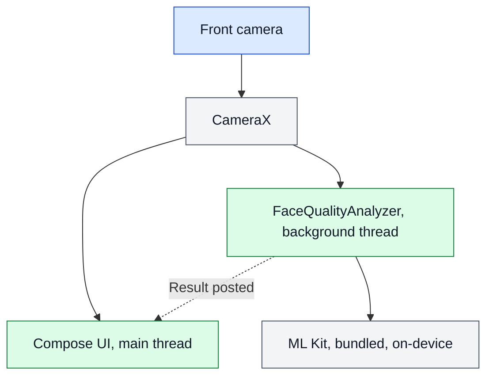
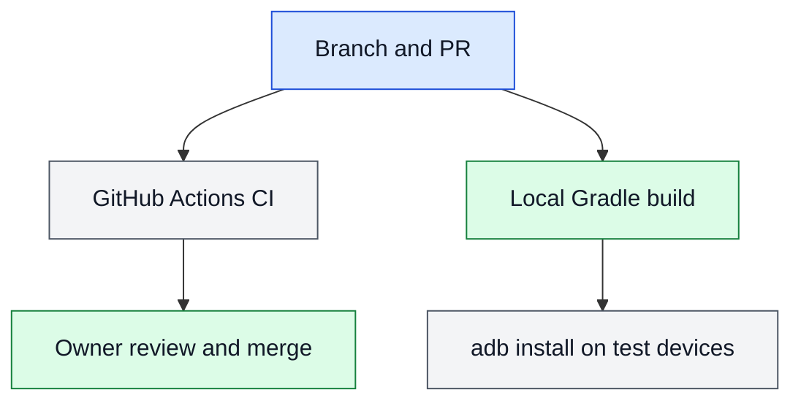

# ARCHITECTURE

What exists and who owns it. Checked against commit `481cb7b` on `perf/ml-kit-background`. Anything marked planned is not built.

## Modules

There is one Gradle module, `:app`.

| File | Owns |
|---|---|
| `MainActivity.kt` | App entry and theme |
| `ui/CameraPreview.kt` | Permission, camera binding, lifecycle, banner |
| `ui/FaceQualityAnalyzer.kt` | Judging a frame on the background thread, closing it, timing log |
| `ui/FaceQuality.kt` | Pure logic: coordinates, face luma, quality decision |
| `ui/QualityPolicy.kt` | Every quality threshold and the policy version |
| `ui/QualityState.kt` | The possible frame results |
| `ui/theme/` | Colours and typography |
| `tools/ci/` | Image allowlist and its check |
| `tools/mock_server/` | Mock enrolment server for development, never deployed |

## Legend

Blue is the way in, green a code step, grey a data store or outside service, and red a trust boundary.

## A1: Runtime topology

The app is a single process with no network code of its own and no server today. Its own manifest declares only `CAMERA`, but the merged manifest also has `INTERNET` and `ACCESS_NETWORK_STATE`, added by `com.google.android.datatransport:transport-backend-cct`, which ML Kit brings in for telemetry. What that library sends has not been measured.

## A2: How a change reaches a device

CI is defined in `.github/workflows/ci.yml` but has never run, because GitHub refused the job over account billing. Deployment and release automation are deferred (D-006). There is no signing, no store release, and no production monitoring.

## A3: Where data lives

| Data | Where | Written by | Lifetime |
|---|---|---|---|
| Camera frames | Memory, one at a time | CameraX | Closed after judging |
| Quality result | Compose state | Analyzer, through the main thread | Replaced on each frame |
| Timing log | Logcat | Analyzer | Device log buffer, aggregates only |

The planned design for captured images, consent, and tokens is in `DATA.md`.

## Trust boundaries

- The camera is the only outside input today.
- ML Kit is a pinned dependency running in-process, and it brings a Google telemetry library with network access. See the known gaps in `THREAT.md`.
- Planned: the enrolment server becomes a second boundary. Only the local mock is approved (D-004).

## Ownership of critical logic

- Frame close and detector failure handling: `FaceQualityAnalyzer.analyze`.
- Teardown order: `DisposableEffect` in `CameraPreview`.
- Quality decision: `qualityFor`, using `QualityPolicy`.
- Backup exclusion: `AndroidManifest.xml` and the two files in `res/xml/`.

## Deployment

None. Debug builds are installed by hand with `adb`.
