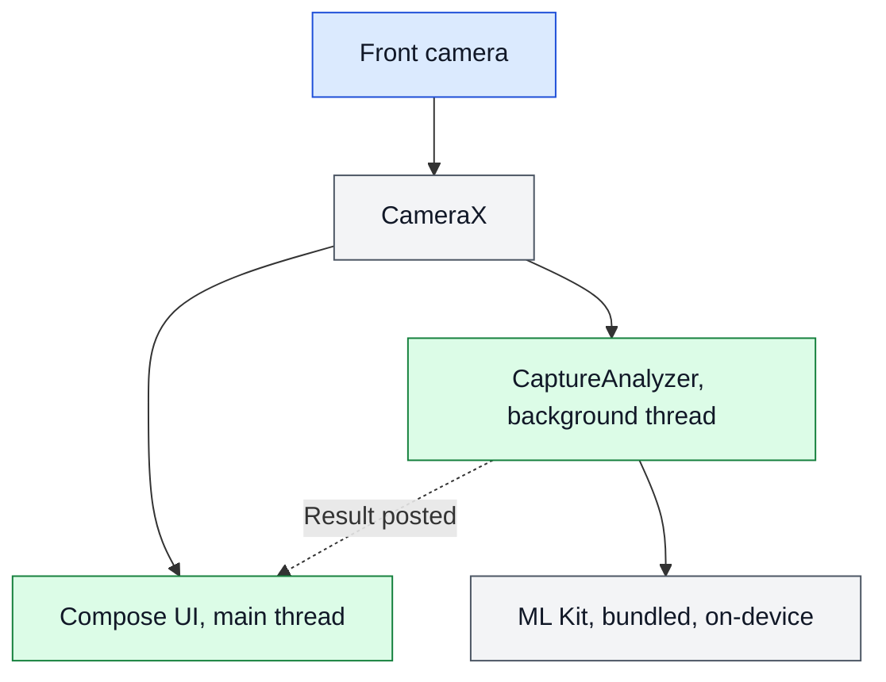
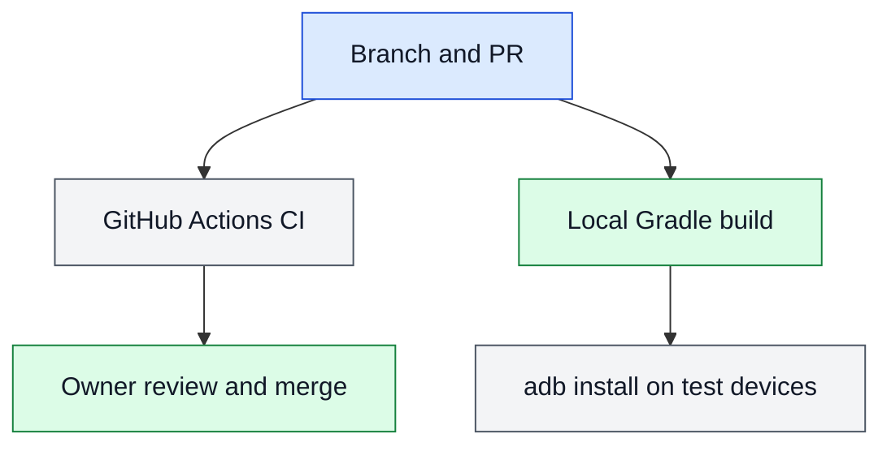

# ARCHITECTURE

What exists and who owns it. Checked against commit `481cb7b` on `perf/ml-kit-background`. Anything marked planned is not built.

## Modules

There is one Gradle module, `:app`.

| File | Owns |
|---|---|
| `MainActivity.kt` | App entry and system bars |
| `ui/EnrolmentViewModel.kt` | Navigation and the session |
| `ui/AppRoot.kt`, `ui/ConnectScreens.kt`, `ui/RosterScreens.kt`, `ui/Components.kt` | Screens and shared controls |
| `ui/SessionRules.kt` | Client check and staff-facing error messages |
| `data/ServerStore.kt` | The server this device is bound to |
| `ui/CaptureScreen.kt` | Camera binding and teardown, guide overlay, capture layouts |
| `ui/CaptureAnalyzer.kt` | Judging a frame on the background thread, keeping the accepted frame, timing log |
| `ui/GuidedCapture.kt` | Pure logic: pose checks, steady timer, blur score, crop |
| `ui/FaceQuality.kt` | Pure logic: coordinates and face luma |
| `ui/QualityPolicy.kt` | Every quality threshold and the policy version |
| `ui/ReviewScreen.kt` | Review and retake |
| `ui/UploadScreens.kt` | Upload progress, result, and rejection |
| `ui/theme/` | Colours and typography |
| `data/EnrolmentApi.kt` | HTTP calls, upload retry, job polling |
| `data/ServerSetup.kt` | Validates the server address and setup code |
| `data/Pose.kt` | The pose set and its contract names |
| `tools/ci/` | Image allowlist and its check |
| `tools/mock_server/` | Mock enrolment server for development, never deployed |

## Legend

Blue is the way in, green a code step, grey a data store or outside service, and red a trust boundary.

## A1: Runtime topology

The app is a single process. The app calls its enrolment server for `server-info` and login. The manifest declares `CAMERA` and `INTERNET`. Separately, `com.google.android.datatransport:transport-backend-cct`, which ML Kit brings in for telemetry, also uses the network, and what it sends has not been measured.

## A2: How a change reaches a device

CI is defined in `.github/workflows/ci.yml` but has never run, because GitHub refused the job over account billing. Deployment and release automation are deferred (D-006). There is no signing, no store release, and no production monitoring.

## A3: Where data lives

| Data | Where | Written by | Lifetime |
|---|---|---|---|
| Camera frames | Memory, one at a time | CameraX | Closed after judging |
| Server address and client | Private app preferences, excluded from backup | Connect step | Until reset |
| Session token | Memory | Login | Until sign-out or process death |
| Guidance | Compose state | Analyzer, through the main thread | Replaced on each frame |
| Captured JPEGs | Memory, `EnrolmentViewModel.photos` | Analyzer, through the main thread | Until 202, cancel, sign-out, or process death |
| Timing log | Logcat | Analyzer | Device log buffer, aggregates only |

The planned design for captured images, consent, and tokens is in `DATA.md`.

## Trust boundaries

- The camera is the only outside input today.
- ML Kit is a pinned dependency running in-process, and it brings a Google telemetry library with network access. See the known gaps in `THREAT.md`.
- Planned: the enrolment server becomes a second boundary. Only the local mock is approved (D-004).

## Ownership of critical logic

- Frame close and detector failure handling: `CaptureAnalyzer.analyze`.
- Teardown order: `DisposableEffect` in `CaptureCamera`.
- Keep or reject a frame: `PoseGuide`, using `QualityPolicy`.
- Backup exclusion: `AndroidManifest.xml` and the two files in `res/xml/`.

## Screen sizes

Phones get one column. Tablets get a wider column, larger text (`tabletFontScale`), short forms centred, and a notice that fills the screen. A large screen held sideways gets two panes for consent and two columns for the roster (`isWideLayout`).

## Themes

The staff screens follow the device light or dark setting (D-010). Colours come from `MaterialTheme` and `LocalStatusColors`, never from fixed values in a screen.

## Deployment

None. Debug builds are installed by hand with `adb`.
