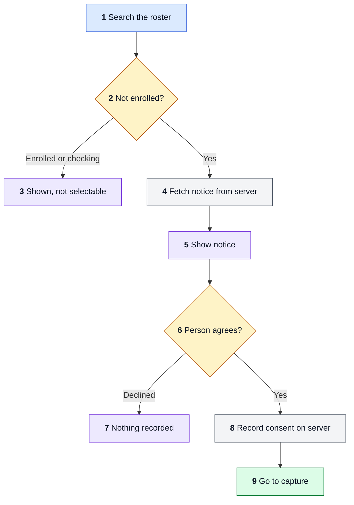
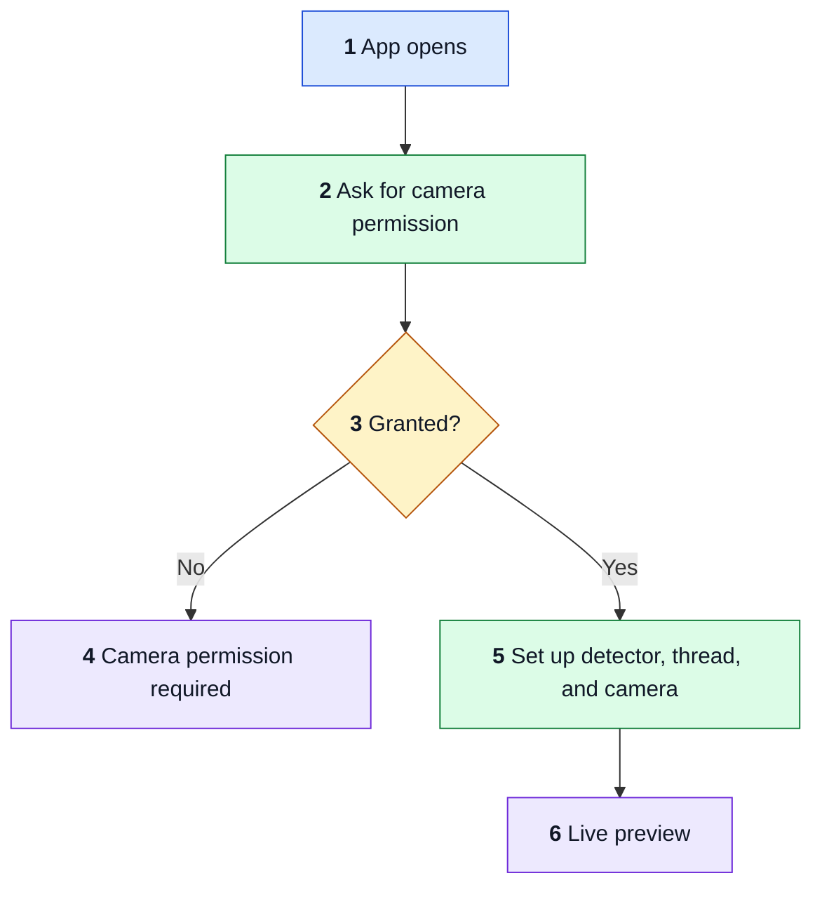
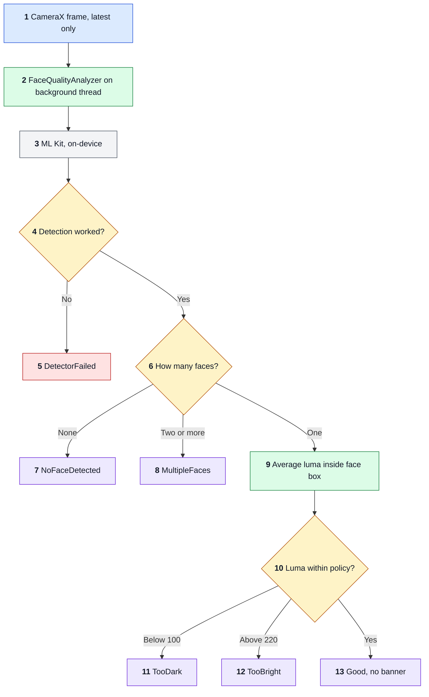

# FLOW

How execution travels through the app. App version 1.0 (`versionCode` 1). F0 was checked against branch `feat/connect-sign-in`, and F1 to F3 against commit `481cb7b`.

The app connects to a server and signs staff in, then shows a front camera preview with a quality warning. It does not capture, store, or upload anything yet. The planned enrolment flows are in `features/FEATURE-001-enrolment.md`.

## How to read the diagrams

Flowcharts read top to bottom. Colours are fixed:

- Blue: the way in.
- Green: a code step.
- Amber: a decision.
- Purple: what the person sees.
- Red: an error.
- Grey: a data store or outside service.

Numbers in a diagram match the numbered trace below it.

## F0: Connect and sign in

1. `MainActivity` creates `EnrolmentViewModel`.
2. `ServerStore` holds the address and client, never a token.
3. `normalizeBaseUrl` refuses anything but a plain HTTPS origin. Debug builds also accept loopback HTTP for the mock.
4. The device binds to the client that answers.
5. Shows `Uploading to:` with the client and host, and a `MOCK SERVER` chip on debug loopback.
6. Runs before the password is sent, so a changed server never receives credentials.
7. `isSameClient` compares `client_id`.
8. A full-screen stop. The only way out is setting up again.
9. A wrong password or unreachable server stays on this screen with a message from `messageFor`.
10. Losing the process signs staff out. Sign-in leads to F0b.

## F0b: Select a person and record consent

1. `search` waits for a pause in typing, and cancels any older search.
2. `PersonRow` allows only `none`.
3. The contract defines no re-enrolment yet.
4. Text and version always come from the server, so each deployment shows its own wording.
5. Rendered natively.
6. Needs the checkbox and a glasses answer.
7. `personDeclined` clears the selection and sends nothing.
8. `POST /api/v1/consents` cites the notice version. The server takes staff from the session.
9. The old preview stands in until the capture flow lands.

A `401` on any of these calls signs staff out and shows `Your session ended. Sign in again.`

## F1: App start and camera permission

1. After sign-in, `AppRoot` shows `CameraPreview`.
2. A `LaunchedEffect` requests `CAMERA` on first compose.
3. `cameraPermissionState.status.isGranted` decides the branch.
4. Denied: a static message. There is no retry button or link to Settings yet.
5. Granted: `remember` creates one `FaceDetector`, one single-thread executor, and the `ImageAnalysis` use case, then `bindToLifecycle` binds the front camera.
6. Preview runs and frames start reaching F2.

## F2: Judging one camera frame

1. `STRATEGY_KEEP_ONLY_LATEST` drops frames while one is being judged.
2. `FaceQualityAnalyzer.analyze` runs on the single background thread. Every path closes the `ImageProxy` in one `finally`.
3. `Tasks.await(detector.process(input))` blocks that thread. ML Kit is the bundled model, so detection runs on-device. Its telemetry library is covered in `THREAT.md`.
4. An exception means the check did not happen.
5. Shown as a failure banner, never as "no face".
6. `qualityFor` in `FaceQuality.kt` decides from the face count.
7. Also the result when a box lies fully outside the frame.
8. Exactly one person must be in frame.
9. `uprightToBuffer` converts the box from upright to buffer coordinates, then `averageLuma` reads the Y plane using its row and pixel stride.
10. Limits are in `QualityPolicy.kt`, version 1, and are not calibrated for a face crop yet.
11. Banner asks for more light.
12. Banner asks for less light.
13. The result posts to the main thread and the banner clears.

`TooBlurry` exists but nothing sets it yet.

## F3: Teardown

1. `DisposableEffect.onDispose` stops new frames.
2. Closing runs on the analyzer thread so it cannot race the running frame.
3. `shutdown` lets queued work finish and accepts nothing new.
4. The frame in progress completes and closes.
5. The detector closes last.

`CameraLifecycleTest` runs this path. Failures would crash the process and fail the test.
