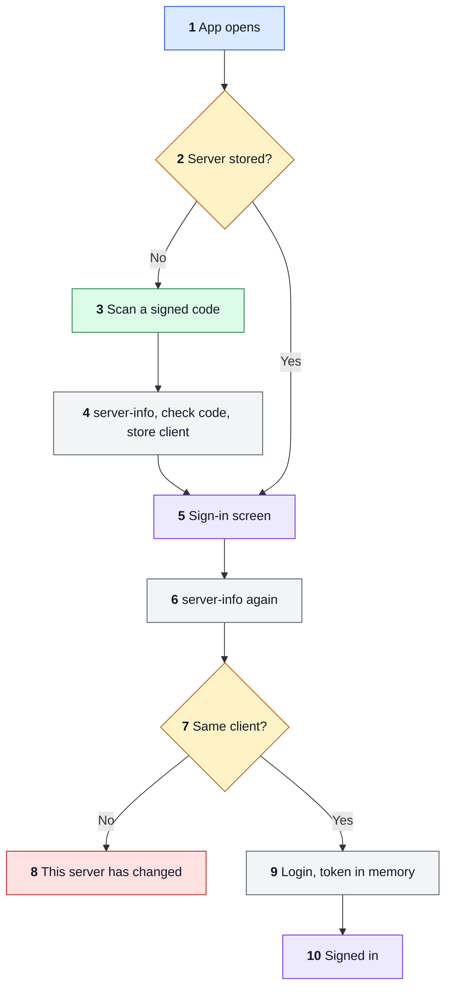
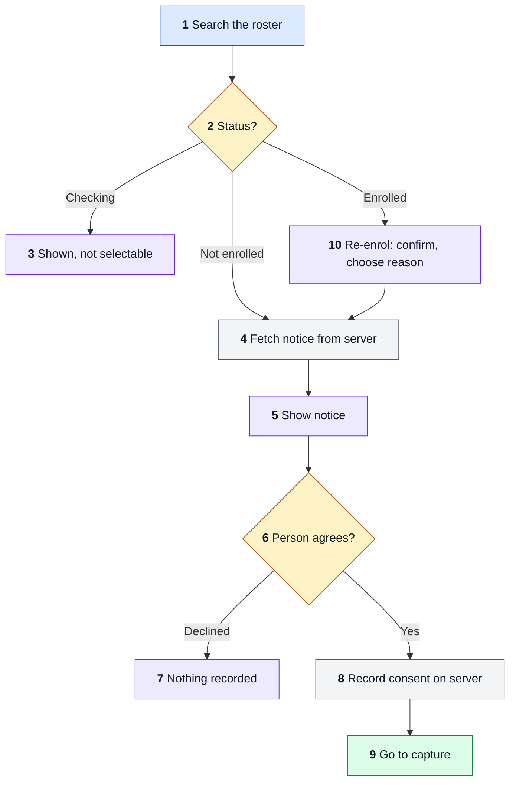
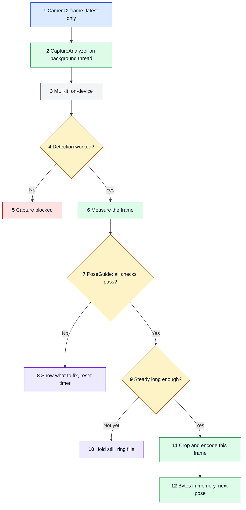
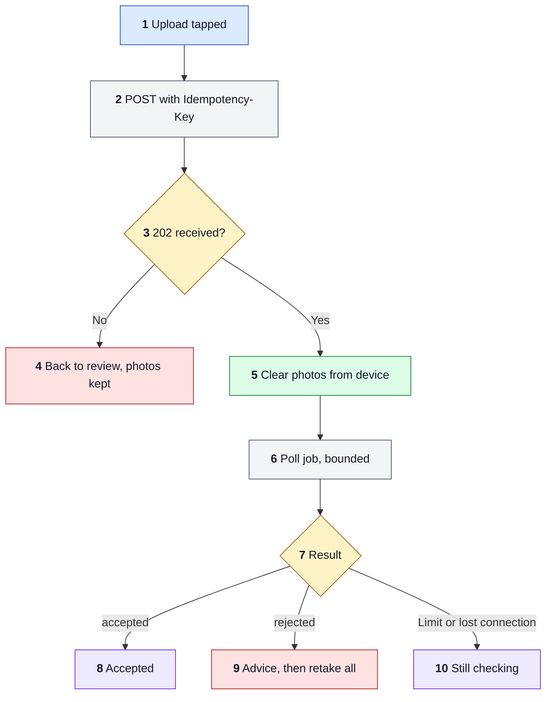
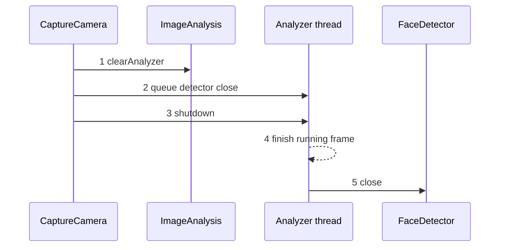

# FLOW

How execution travels through the app. App version 1.0 (`versionCode` 1). Checked against branch `feat/re-enrol`.

The app connects to a server and signs staff in, then guides 5 or 10 poses, holds the photos in memory for review, and uploads them. The enrolment plan is in `features/FEATURE-001-enrolment.md`.

## How to read the diagrams

Flowcharts read top to bottom. Colours are fixed:

- Blue: the way in.
- Green: a code step.
- Amber: a decision.
- Purple: what the person sees.
- Red: an error.
- Grey: a data store or outside service.

Numbers in a diagram match the numbered trace below it.

## F0: Connect and sign in

1. `MainActivity` creates `EnrolmentViewModel`.
2. `ServerStore` holds the address and client, never a token.
3. `QrScanScreen` reads the back camera and keeps no frame. `parseSetupCode` needs `base_url`, `client_id`, and a valid signature (D-020). `normalizeBaseUrl` refuses anything but a plain HTTPS origin, for both routes. Debug builds also accept loopback HTTP for the mock. Debug builds can also type an address. A bad code, a camera failure, or cancel returns to the connect screen.
4. The device binds to the client that answers. A scanned code must name that client, or `requireClient` refuses and nothing is stored. The signed name is what staff see. A typed address, debug only, has no client to compare.
5. Shows `Uploading to:` with the client and host, and a `MOCK SERVER` chip on debug loopback.
6. Runs before the password is sent, so a changed server never receives credentials.
7. `isSameClient` compares `client_id`.
8. A full-screen stop. The only way out is setting up again.
9. A wrong password or unreachable server stays on this screen with a message from `messageFor`.
10. Losing the process signs staff out. Sign-in leads to F0b.

## F0b: Select a person and record consent

1. `search` waits for a pause in typing, and cancels any older search.
2. Tapping a `PersonRow` starts only for `none`.
3. One open job per person, so `pending` stays blocked.
4. Text and version always come from the server, so each deployment shows its own wording.
5. Rendered natively.
6. Needs the checkbox and a glasses answer.
7. `personDeclined` clears the selection and sends nothing.
8. `POST /api/v1/consents` cites the notice version. The server takes staff from the session.
9. Continues in F1.
10. An enrolled row has a `Re-enrol` button. `ReEnrolDialog` needs a reason, which is held until the upload. The person still sees the notice and agrees again (D-012).

A `401` on any of these calls signs staff out and shows `Your session ended. Sign in again.`

## F1: Guided capture of one pose

A 10-photo set first stops on `GlassesStepScreen`, and again before each switch and each retake (D-019). The camera stays closed there, so nothing captures until staff confirm.

1. `STRATEGY_KEEP_ONLY_LATEST` drops frames while one is being judged. The requested size is 1920 x 1080.
2. `CaptureAnalyzer.analyze` runs on one background thread. Every path closes the `ImageProxy` in one `finally`.
3. `Tasks.await` blocks that thread, using FAST mode with landmarks. Detection runs on-device. Telemetry is covered in `THREAT.md`.
4. An exception means the check did not happen.
5. Shown as a failure, never as "no face".
6. Euler angles, luma and `blurScore` on the face box, face width, centre offset, pupil distance.
7. `PoseGuide.problemWith` checks one face, framing, pupil distance on front poses, head level, pose angle, light, and blur. There is no eyes-open check, because eyelids drop in the chin-down pose.
8. Any failure resets the timer. So does a frame gap over `MAX_FRAME_GAP_MS`.
9. Uses monotonic time. Moving more than `STEADY_DEGREES` restarts the wait.
10. Fires `TakePhoto` once per pose.
11. `encode` rotates and crops the same frame to 4:5 with `portraitCrop`. Analysis frames are unmirrored, so the JPEG is too, unlike the preview.
12. `onPhoto` ignores a stale photo. Bytes go in `EnrolmentViewModel.photos`, and never to disk.

All limits are in `QualityPolicy.kt` and are not calibrated yet.

## F2: Review and leaving

Staff see every photo and can retake one pose, which returns to F1 for that pose only. Nothing is sent until they upload. Cancel and the back key ask first, then clear the photos, and the consent stays on record unless staff choose `Person withdrew consent`, which also calls `DELETE /consents`. After more than `BACKGROUND_LIMIT_MS` away from the app, photos are cleared and staff are signed out. `FLAG_SECURE` blocks screenshots and the recents thumbnail on capture and review.

## F2b: Upload and result

1. `upload` reuses `uploadKey` for this exact set. Any changed photo clears it.
2. `EnrolmentApi.upload` retries an unknown outcome or a 5xx, 3 attempts, always with the same key.
3. 202 is durable, so only this answer clears photos.
4. Every photo stays in memory, with a message. Trying again reuses the key.
5. `photos.clear()`.
6. `awaitJob`, every 2 s, up to 30 polls.
7. A poll that loses the connection is not a failed enrolment, because the server already has the photos.
8. `Enrol next person` returns to a refreshed roster.
9. The server deleted the set. `retakeAll` restarts capture under a new key with the same consent. A re-enrolment keeps its reason, and the old enrolment stays in use.
10. The result appears on the roster.

## F3: Teardown

1. `DisposableEffect.onDispose` clears the target and stops new frames.
2. Closing runs on the analyzer thread so it cannot race the running frame.
3. `shutdown` lets queued work finish and accepts nothing new.
4. The frame in progress completes and closes.
5. The detector closes last.

`CameraLifecycleTest` runs this path. Failures would crash the process and fail the test.
